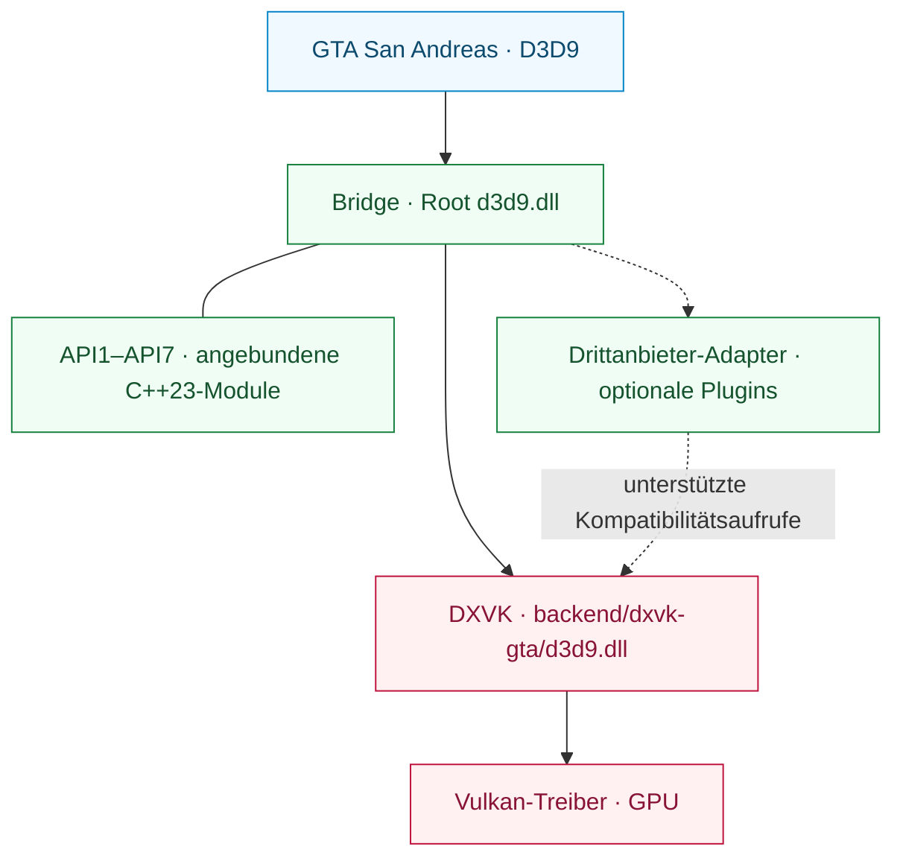

<div align="center">

# SA RenderStack

**Eine modulare Rendering-Laufzeitumgebung für Grand Theft Auto: San Andreas.**

D3D9-Kompatibilität · Vulkan-Ausführung · Inspektionierbare Rendering-Diagnostik

[English](README.md) | [Português (Brasil)](README.pt-BR.md) | [Español](README.es.md) | [Русский](README.ru.md) | [Français](README.fr.md) | [Deutsch](README.de.md) | [日本語](README.ja.md) | [한국어](README.ko.md) | [简体中文](README.zh-CN.md)

[](https://github.com/prematurely/sa-renderstack/actions/workflows/windows-ci.yml)
[](https://github.com/prematurely/sa-renderstack/releases/tag/v0.1.0-alpha.1)
[](#build)
[](#architecture)
[](#compatibility)

[Download](https://github.com/prematurely/sa-renderstack/releases/tag/v0.1.0-alpha.1) | [Schnellstart](#quick-start) | [Architektur](#architecture) | [API-Module](#api-modules) | [Build](#build) | [Dokumentation](#documentation)

</div>

---

SA RenderStack vereint eine D3D9-Bridge, einen GTA-kompatiblen DXVK-Fork und Rendering-Diagnosewerkzeuge in einem einzigen Quellcodeprojekt. Die Bridge verwaltet den Haupteinstiegspunkt, konfigurierte Drittanbieter-Integrationen und Kompatibilitätsadapter. DXVK implementiert D3D9 und steuert die Ausführung über Vulkan.

> **Release-Basislinie:** `v0.1.0-alpha.1`, GTA San Andreas **1.0 US / x86**, mit **zwei Runtime-DLLs**. Diese README beschreibt auch den aktuellen Entwicklungszweig einschließlich der C++23-API-Teilprojekte. Das Vorhandensein eines Features im Quellcode garantiert nicht, dass es im veröffentlichten Archiv enthalten ist.

<a id="capabilities"></a>
## Funktionsumfang

| Ebene | Leistungsmerkmale |
| :--- | :--- |
| **Bridge** | Ein einzelner D3D9-Root-Einstiegspunkt, geordnete Modulregistrierung, Hook-Zugehörigkeitsmetadaten und optionale Plugin-Lebenszyklus-Callbacks. |
| **DXVK-Backend** | D3D9-zu-Vulkan-Übersetzung mit in die Backend-DLL integrierten DXGI-Factory-Exports. |
| **Drittanbieter-Integration** | Kompatibilitätsadapter, selektives natives State-Journaling und Batch-Zustandsübermittlung, sofern zulässig. |
| **API1–API7** | Sieben der Bridge zugeordnete C++23-Teilprojekte mit Bibliotheksquellen, Entwicklungsbeispielen und Tests. |
| **Diagnostik** | State-Attribution, CPU-Hotspot-Sampling, Draw-Traces und Backend-Ausführungsstatistiken. |
| **Release-Werkzeuge** | Quellcode-Provenienz, ABI-/Export-Prüfungen, Build-Metadaten, Paket-Manifeste und Validierung von Rollback-Dateien. |

State-Block-Filterung, verzögerte Bindungen (deferred bindings), Ressourcen-Caches und optionale Thread-Planung sind konfigurierbare Experimente. Ihr Vorhandensein garantiert keine Leistungssteigerung für jede Arbeitslast.

<a id="quick-start"></a>
## Schnellstart

1. Laden Sie **`SA-RenderStack-v0.1.0-alpha.1-split.zip`** von der [Release-Seite](https://github.com/prematurely/sa-renderstack/releases/tag/v0.1.0-alpha.1) herunter.
2. Schließen Sie das Spiel und alle Launcher-Prozesse. Sichern Sie alle Dateien, die durch das Paket ersetzt werden, einschließlich beider Runtime-DLLs und der Konfigurationsdateien.
3. Entpacken Sie das Archiv unter Beibehaltung der Ordnerstruktur in das Spielverzeichnis, das `gta_sa.exe` enthält.
4. Überprüfen Sie das Laden vom Menü in einen Spielstand und validieren Sie anschließend repräsentative Szenen sowie die vorgesehene Mod-Konfiguration.

Das Split-Archiv ist das eigentliche Runtime-Paket. SDK- und Symbol-Archive dienen der Entwicklungsunterstützung; die Installation erfordert weder einen Compiler noch PowerShell.

Lesen Sie vor dem Ersetzen einer bestehenden Installation die [Installations- und Rollback-Anleitung](docs/installation.md).

<a id="runtime-layout"></a>
## Laufzeit-Dateistruktur

```text
<GTA-Verzeichnis>/
  gta_sa.exe
  d3d9.dll                       # Bridge-Einstiegspunkt
  SA.RenderStack.ini             # Bridge-Konfiguration
  dxvk.conf                      # Backend-Konfiguration
  backend/
    dxvk-gta/d3d9.dll            # DXVK D3D9 + DXGI Backend
  scripts/
    BridgeD3D9.ini               # Veralteter (Legacy-) Konfigurationspfad
```

**Belassen Sie beide DLLs an ihren zugewiesenen Pfaden.** Das Überschreiben der Stamm-`d3d9.dll` mit der Backend-DLL umgeht die Bridge. Die zusammengeführten DXGI-Exporte gehören zum Backend; es handelt sich weiterhin um eine Laufzeitumgebung mit zwei getrennten DLLs.

<a id="architecture"></a>
## Architektur



Die Bridge verwaltet Integration und Diagnostik. DXVK kontrolliert den autoritativen D3D9-Zustand, das Vulkan-Device, Ressourcen, den Befehlsstrom und die Queue-Übermittlung. Zustandsoptimierungen müssen die native Journal-Wiederherstellung und State-Block-Änderungen in dieser autoritativen Schicht zwingend berücksichtigen.

API2-Callbacks zeichnen in den bestehenden Present-Befehlspuffer auf. Sie müssen jedes geänderte Image-Layout wiederherstellen und dürfen aus ihrem Callback heraus weder eigenständig übermitteln, beenden, zurücksetzen noch sich rekursiv registrieren. Siehe [Modulübersicht](docs/architecture/module-map.md) und [Backend-API-Vertrag](sdk/include/sa_renderstack/backend_api.h).

<a id="api-modules"></a>
## API1–API7 Teilprojekte

**Eine übergeordnete Laufzeitumgebung, sieben Code-Module.** Beide Win32-Bridge-Projekte binden diese Implementierungen aus `src/bridge/legacy/api-projects/` ein. Deren Beispiele und Tests sind Entwicklungsziele und keine sieben unabhängig voneinander bereitgestellten Programme.

| API | Zugeordnetes Teilprojekt | Zuständigkeit |
| :---: | :--- | :--- |
| **1** | [Status](src/bridge/legacy/api-projects/api1-status/) | Versions-/Funktionsprüfung und Zugriff auf Vulkan-Interop. |
| **2** | [Vulkan Pass](src/bridge/legacy/api-projects/api2-vulkan-pass/) | Pass-Registrierung, Ausführungsreihenfolge und Abmeldung. |
| **3** | [State Batch](src/bridge/legacy/api-projects/api3-state-batch/) | Übermittlung von Shader-Konstantenbereichen und Texturbindungen. |
| **4** | [State Journal](src/bridge/legacy/api-projects/api4-state-journal/) | Erfassung und Wiederherstellung unterstützter Pipeline-Zustände. |
| **5** | [Effect Batch](src/bridge/legacy/api-projects/api5-effect-batch/) | Übermittlung des finalen Effekt-Pass-Zustands als Batch. |
| **6** | [State + Draw](src/bridge/legacy/api-projects/api6-state-draw/) | Übermittlung eines State-Batches und eines unmittelbaren DP/DIP-Aufrufs. |
| **7** | [Selective Journal](src/bridge/legacy/api-projects/api7-selective-journal/) | Begrenzung der Erfassung auf eigene Effektoperationen. |

Schnittstellenverfügbarkeit, Kompilierung in die Bridge und produktive Übernahme sind separate Sachverhalte. Das aktuelle Profil führt API3 und API7 über einen konfigurierten Drittanbieter-Integrationspfad aus. API2 benötigt einen registrierten Pass; API5/API6-Bibliotheken und Beispiele begründen keine Verwendung im zeitkritischen Pfad (Hot Path) des Spiels. API6 ist eine **Single-Draw**-Schnittstelle, keine Multi-Objekt- oder Multi-Draw-Warteschlange.

Hierbei handelt es sich um Versionen der Backend-Kompatibilitäts-API. Die separate [Bridge-Plugin-API](src/bridge/legacy/BridgeD3D9Plugin.h) verwendet eine eigene v1/v2-Versionierung.

<a id="configuration"></a>
## Konfiguration

| Datei | Zuständigkeit |
| :--- | :--- |
| [SA.RenderStack.ini](config/SA.RenderStack.ini) | Bridge-Integration, Modul-Registry, Diagnostik und optionale Thread-Planung. |
| [dxvk.conf](config/dxvk.conf) | DXVK-Optionen, GTA-Kompatibilitätsfeatures, Frame-Pacing und HUD. |

Die aktuelle Bridge liest zuerst die `SA.RenderStack.ini` im Hauptverzeichnis und greift bei Fehlen auf `scripts/BridgeD3D9.ini` zurück. Halten Sie bei Verwendung älterer Builds beide Kopien synchron. Verwenden Sie die mit dem gewählten Release mitgelieferte Konfiguration als Referenz.

Die Registry überwacht konfigurierte Drittanbietermodule und stellt deaktivierte Einträge für optionale Integrationen bereit. Fehlende Komponenten von Drittanbietern werden von der Registry nicht automatisch installiert. Einzelheiten finden Sie unter [Proxy- und Plugin-Hosting](src/bridge/legacy/POSTFX_CHAIN.md).

> **Entwicklungskonfiguration:** Optionale Einstellungen wie `[Affinity] PerThread` und `Mmcss` sind standardmäßig auf `0` gesetzt. Ihre Aktivierung ist experimentell und stellt keine Echtzeit- oder Exklusivkern-Garantie dar. Diagnose-HUD-Inhalte und Optimierungsschalter können vom veröffentlichten Alpha-Profil abweichen.

<a id="build"></a>
## Aus dem Quellcode bauen

Das Haupt-Build-Ziel ist **Windows / Release / x86**. Der aktuelle Quellcode verwendet **C++23**; die Bridge-Projekte wählen den MSVC-Modus `stdcpplatest`, und die CMake-Targets der API erfordern `cxx_std_23`.

| Toolchain | Zweck |
| :--- | :--- |
| PowerShell 7 und Git | Build-Orchestrierung und historische Provenienzprüfungen. |
| Visual Studio 18 C++ Build Tools | Bridge- und MSVC-Testziele; Toolset `v145`. |
| LLVM-MinGW, Python 3, Meson, Ninja, glslang | x86-DXVK-Backend und Shader-Kompilierung. |
| CMake 3.25+ | Optionaler zusammengefasster Build von API-Beispielen und Unit-Tests. |

Führen Sie die Befehle im Stammverzeichnis des Repositorys aus:

```powershell
pwsh -NoProfile -File tools/build.ps1 `
  -Configuration Release -Architecture x86 -Component All -Clean

pwsh -NoProfile -File tools/test.ps1 `
  -Configuration Release -Architecture x86
```

Build-Artefakte werden in `out/` abgelegt; diese Befehle installieren nichts im Spielverzeichnis. Verwenden Sie `-Help` bei den jeweiligen Skripten, um explizite Werkzeugpfade und umgebungsspezifische Optionen einzusehen.

<details>
<summary><strong>Bauen der angebundenen API-Beispiele und Tests</strong></summary>

Konfigurieren Sie das übergeordnete Gesamtziel, nicht ein einzelnes API-Verzeichnis:

```powershell
cmake -S src/bridge/legacy/api-projects -B out/api-project-build/all `
  -G "Visual Studio 18 2026" -A Win32
cmake --build out/api-project-build/all --config Release
ctest --test-dir out/api-project-build/all -C Release --output-on-failure
```

Der primäre MSBuild-Pfad kompiliert die API-Quellen direkt in die Bridge. Dieser optionale CMake-Pfad baut zusätzlich die Beispiele und deren Unit-Tests. Führen Sie GPU-Beispiele mit einer expliziten DXVK-Kompatibilitätskonfiguration auf dem vorgesehenen Backend aus.

</details>

<a id="validation"></a>
## Validierung und Paketierung

Nach erfolgreichem Build und Testlauf:

```powershell
pwsh -NoProfile -File tools/package.ps1 `
  -Version 0.1.0-alpha.1 -Configuration Release
pwsh -NoProfile -File tests/package-layout-test.ps1
pwsh -NoProfile -File tools/release-gate.ps1 `
  -Version 0.1.0-alpha.1 -Configuration Release
```

| Nachweis | Ausgabe |
| :--- | :--- |
| Build-Identität und Binär-Hashes | `out/build-metadata.json` |
| Einzelergebnisse, Fehler und übersprungene Tests | `out/test-results.json` |
| Split-, SDK-, Symbol-Pakete und Quellcode-Manifest | `out/packages/` |
| Lokales Release-Gate-Ergebnis | `out/reports/phase-1-release-gate.md` |

Die [Windows CI](.github/workflows/windows-ci.yml) führt Build-, Test-, Paketierungs- und Paketprüfungen durch. Gehostete Testläufe überspringen GPU-Prüfungen und lokale Spielüberprüfungen explizit und protokollieren die Gründe im Testbericht. Ein grünes CI-Badge ersetzt weder das praktische Testen im Spiel noch das lokale Release-Gate.

<a id="diagnostics"></a>
## Diagnostik

| Aufzeichnung | Ausgabedatei | Verwendung |
| :--- | :--- | :--- |
| **F7** | `scripts/BridgeD3D9.state-attribution.log` und DXVK-Sitzungsprotokolle | Effekt-/State-Attribution und Backend-Batching. |
| **F8** | `scripts/BridgeD3D9.cpuhotspots.log`, `Diagnostics/CPU/` | CPU-Hotspot-Samples und Aufnahme-Screenshots. |
| **F9** | `scripts/BridgeD3D9.callsites.log` | Optionale D3D9-Aufrufstellen-Abtastung. |
| **F10** | `scripts/BridgeD3D9.drawtrace.log` | Optionale State-Ablaufverfolgung pro Draw-Call. |
| **Backend** | `Diagnostics/DXVK/` | Geräte-, Konfigurations- und Sitzungsdiagnostik. |

Tastenbelegungen und Ausgaben hängen von der aktiven Konfiguration ab. Detaillierte Aufzeichnungen und HUD-Abfragen verursachen Overhead; messen Sie die reguläre Rendering-Leistung separat unter identischen Bedingungen (Szene, Binärdateien und Konfiguration).

<a id="compatibility"></a>
## Kompatibilität und Geltungsbereich

Die Referenzbasis ist **GTA San Andreas 1.0 US, 32-Bit**, unter Verwendung des Bridge-Einstiegspunkts und eines von DXVK v3.0.1 abgeleiteten Vulkan-Backends. Ein funktionsfähiger Vulkan-Treiber ist für dieses Backend erforderlich.

Das veröffentlichte Paket zielt auf die x86 Split-DLL-Laufzeitumgebung für GTA San Andreas 1.0 US ab. Die Registry und die Kompatibilitäts-APIs bieten Erweiterungspunkte für Drittanbieter-Integrationen; die Unterstützung einer bestimmten Kombination hängt von deren Schnittstellenvertrag und den Validierungsergebnissen ab. Die Single-DLL-Laufzeitumgebung bleibt ein separates Entwicklungsziel.

FPS, Textur-Streaming, Shader-Darstellung, Eingabelatenz und Langzeitstabilität müssen mit einer festen, reproduzierbaren Testlast gemessen werden. Siehe [bekannte Audit-Ergebnisse und manuelle Prüfungen](docs/development/known-audit-findings.md).

<a id="documentation"></a>
## Dokumentation

| Leitfaden | Schwerpunkt |
| :--- | :--- |
| [Installation](docs/installation.md) | Archivstruktur, Erststart und Rollback. |
| [Architektur](docs/architecture/module-map.md) | Modulzuständigkeiten und Rendering-Verträge. |
| [API-Teilprojekte](src/bridge/legacy/api-projects/README.md) | Die sieben Bridge-eigenen Code-Module. |
| [Maintainer-Übergabe](docs/development/phase-1-handoff.md) | Kontext zu Build und Release. |
| [Audit-Ergebnisse](docs/development/known-audit-findings.md) | Bekannte Einschränkungen und Validierungsanforderungen. |
| [Release-Notes](docs/releases/0.1.0-alpha.1.md) | Umfang der veröffentlichten Alpha-Version. |

```text
backend/dxvk/                    Vulkan-Backend und GTA-Kompatibilitätsschicht
src/bridge/legacy/               Haupt-Bridge-Laufzeitumgebung und Adapter
  api-projects/                  Sieben angebundene C++23-API-Teilprojekte
sdk/include/sa_renderstack/      Öffentliche Backend-API
config/                         Versionierte Laufzeitprofile
docs/                           Architektur-, Entwicklungs- und Release-Dokumentation
packaging/                      Spezifikationen für das Paket-Layout
tests/                          Quellcode-, ABI-, Paketierungs- und Regressionsprüfungen
tools/                          Build-, Test-, Paketierungs- und Release-Automatisierung
```

<a id="licenses"></a>
## Herkunft und Lizenzen

Das Backend basiert auf dem [offiziellen DXVK v3.0.1](https://github.com/doitsujin/dxvk/tree/v3.0.1). Dessen [Upstream-Identität](backend/dxvk/SA_RENDERSTACK_UPSTREAM.toml) und [Abhängigkeitsrevisionen](backend/dxvk/SA_RENDERSTACK_DEPENDENCIES.toml) sind im Quellbaum hinterlegt.

SA-RenderStack-spezifischer Code unterliegt der [zlib/libpng-Lizenz](LICENSE). Integrierte Drittanbieterkomponenten behalten ihre jeweiligen Lizenzen, aufgeführt in den [Hinweisen zu Drittanbieter-Software](THIRD_PARTY_NOTICES.md). Generierte Quellcode-Manifeste dokumentieren Datei-Hashes und Toolchain-Metadaten für jeden Release-Kandidaten.
