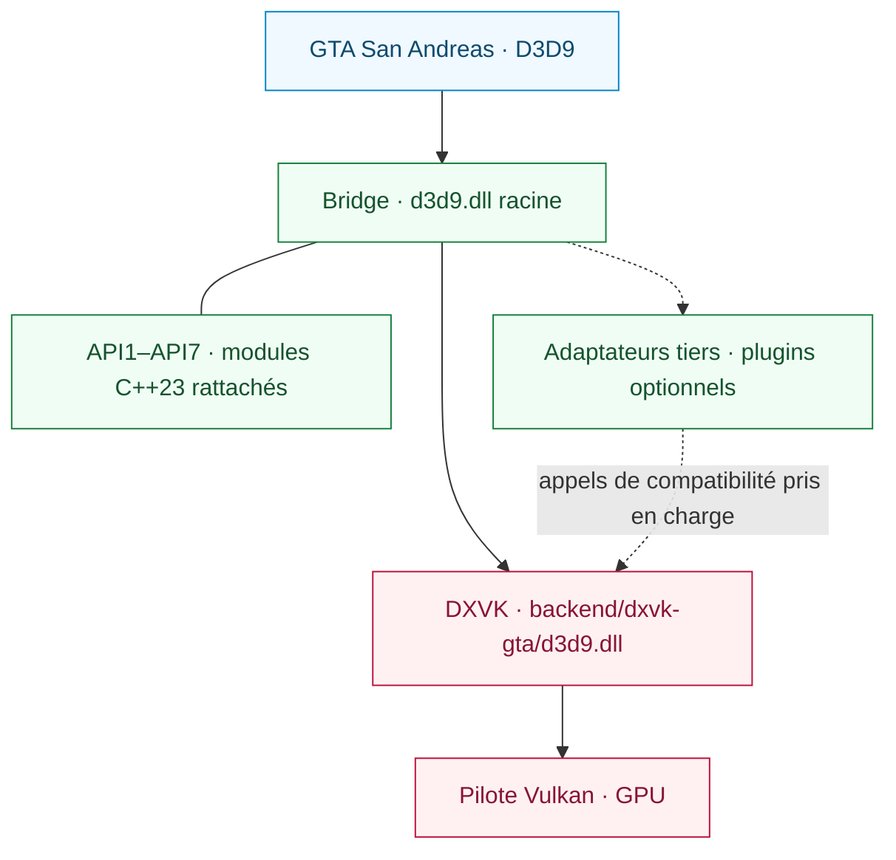

<div align="center">

# SA RenderStack

**Un runtime de rendu modulaire pour Grand Theft Auto: San Andreas.**

Compatibilité D3D9 · Exécution Vulkan · Diagnostics de rendu inspectables

[English](README.md) | [Português (Brasil)](README.pt-BR.md) | [Español](README.es.md) | [Русский](README.ru.md) | [Français](README.fr.md) | [Deutsch](README.de.md) | [日本語](README.ja.md) | [한국어](README.ko.md) | [简体中文](README.zh-CN.md)

[](https://github.com/prematurely/sa-renderstack/actions/workflows/windows-ci.yml)
[](https://github.com/prematurely/sa-renderstack/releases/tag/v0.1.0-alpha.1)
[](#build)
[](#architecture)
[](#compatibility)

[Téléchargement](https://github.com/prematurely/sa-renderstack/releases/tag/v0.1.0-alpha.1) | [Démarrage rapide](#quick-start) | [Architecture](#architecture) | [Modules d'API](#api-modules) | [Compilation](#build) | [Documentation](#documentation)

</div>

---

SA RenderStack réunit au sein d'un même projet source un pont D3D9 (Bridge), un fork de DXVK compatible GTA et des outils de diagnostic de rendu. Le Bridge gère le point d'entrée, les intégrations tierces configurées et les adaptateurs de compatibilité. DXVK implémente D3D9 et prend en charge l'exécution sur Vulkan.

> **Base de référence de la release :** `v0.1.0-alpha.1`, GTA San Andreas **1.0 US / x86**, avec **deux DLL d'exécution**. Ce README décrit également l'arbre de développement actuel, y compris ses sous-projets d'API en C++23. La présence d'une fonctionnalité dans le code source ne garantit pas son inclusion dans l'archive publiée.

<a id="capabilities"></a>
## Fonctionnalités

| Couche | Ce qu'elle apporte |
| :--- | :--- |
| **Bridge** | Un point d'entrée racine D3D9 unique, un enregistrement ordonné des modules, des métadonnées de propriété des hooks et des rappels (callbacks) optionnels de cycle de vie des plugins. |
| **Backend DXVK** | Traduction de D3D9 vers Vulkan avec exportations de fabrique DXGI fusionnées dans la DLL du backend. |
| **Intégration tierce** | Adaptateurs de compatibilité, journalisation (journaling) sélective de l'état natif et soumission d'état par lots (batching) le cas échéant. |
| **API1–API7** | Sept sous-projets C++23 rattachés au Bridge, comprenant code source de bibliothèque, exemples de développement et tests. |
| **Diagnostics** | Attribution d'état, échantillonnage des points chauds CPU (hotspots), traces de rendu (draw traces) et statistiques d'exécution du backend. |
| **Outillage de publication** | Traçabilité des sources, vérifications ABI/exports, métadonnées de compilation, manifestes de paquets et validation des fichiers de restauration (rollback). |

Le filtrage des blocs d'état (state-blocks), les liaisons différées (deferred bindings), les caches de ressources et l'ordonnancement optionnel des threads sont des fonctionnalités expérimentales configurables. Leur présence ne garantit pas un gain de performances pour toutes les charges de travail.

<a id="quick-start"></a>
## Démarrage rapide

1. Téléchargez **`SA-RenderStack-v0.1.0-alpha.1-split.zip`** depuis la [page des releases](https://github.com/prematurely/sa-renderstack/releases/tag/v0.1.0-alpha.1).
2. Fermez le jeu et tout processus de lancement. Sauvegardez chaque fichier que le paquet remplacera, y compris les deux DLL d'exécution et les fichiers de configuration.
3. Extrayez l'archive dans le répertoire du jeu contenant `gta_sa.exe`, en conservant l'arborescence des dossiers.
4. Vérifiez le chargement depuis le menu jusqu'à une sauvegarde, puis validez des scènes représentatives ainsi que la configuration de mods prévue.

L'archive fractionnée (`split`) constitue le paquet d'exécution. Les archives SDK et symboles sont des aides au développement ; l'installation ne nécessite ni compilateur ni PowerShell.

Consultez le [guide d'installation et de restauration](docs/installation.md) avant de remplacer une installation existante.

<a id="runtime-layout"></a>
## Disposition des fichiers au runtime

```text
<Répertoire GTA>/
  gta_sa.exe
  d3d9.dll                       # Point d'entrée Bridge
  SA.RenderStack.ini             # Configuration du Bridge
  dxvk.conf                      # Configuration du backend
  backend/
    dxvk-gta/d3d9.dll            # Backend DXVK D3D9 + DXGI
  scripts/
    BridgeD3D9.ini               # Emplacement de configuration hérité (legacy)
```

**Conservez les deux DLL à leurs emplacements respectifs.** Copier la DLL backend sur le `d3d9.dll` racine contournerait le Bridge. Les exports DXGI fusionnés appartiennent au backend ; l'architecture repose sur deux DLL distinctes.

<a id="architecture"></a>
## Architecture



Le Bridge gère l'intégration et les diagnostics. DXVK détient l'état D3D9 faisant autorité, le périphérique Vulkan, les ressources, le flux de commandes et la soumission à la file d'attente (queue). Les optimisations d'état doivent impérativement prendre en compte la restauration du journal natif et les modifications de blocs d'état au sein de cette couche d'autorité.

Les rappels (callbacks) d'API2 enregistrent dans le tampon de commandes Present existant. Ils doivent obligatoirement restaurer toute disposition d'image modifiée et ne doivent en aucun cas soumettre, terminer, réinitialiser ou s'enregistrer de manière récursive depuis le callback. Consultez le [plan des modules](docs/architecture/module-map.md) et le [contrat de l'API backend](sdk/include/sa_renderstack/backend_api.h).

<a id="api-modules"></a>
## Sous-projets API1–API7

**Un runtime parent unique, sept modules de code.** Les deux projets Win32 du Bridge incluent ces implémentations depuis `src/bridge/legacy/api-projects/`. Leurs exemples et tests sont des cibles de développement, et non sept programmes déployés indépendamment.

| API | Sous-projet rattaché | Rôle |
| :---: | :--- | :--- |
| **1** | [Status](src/bridge/legacy/api-projects/api1-status/) | Inspection des versions/capacités et accès interop Vulkan. |
| **2** | [Vulkan Pass](src/bridge/legacy/api-projects/api2-vulkan-pass/) | Enregistrement, ordonnancement et désenregistrement des passes. |
| **3** | [State Batch](src/bridge/legacy/api-projects/api3-state-batch/) | Soumission de plages de constantes de shader et liaisons de textures. |
| **4** | [State Journal](src/bridge/legacy/api-projects/api4-state-journal/) | Capture et restauration des états de pipeline pris en charge. |
| **5** | [Effect Batch](src/bridge/legacy/api-projects/api5-effect-batch/) | Soumission groupée de l'état de passe d'effet final. |
| **6** | [State + Draw](src/bridge/legacy/api-projects/api6-state-draw/) | Soumission d'un lot d'états et d'un appel immédiat DP/DIP. |
| **7** | [Selective Journal](src/bridge/legacy/api-projects/api7-selective-journal/) | Restriction de la capture aux opérations d'effets détenues. |

La disponibilité d'une interface, sa compilation dans le Bridge et son adoption effective en production sont des faits distincts. Le profil actuel sollicite API3 et API7 via une voie d'intégration tierce configurée. API2 nécessite une passe enregistrée ; les bibliothèques et exemples API5/API6 n'établissent pas une utilisation sur le chemin critique (hot path) du jeu. API6 est une interface à **tirage unique (single-draw)**, et non une file d'attente multi-objets ou multi-draw.

Il s'agit des versions d'API de compatibilité du backend. L'[API de plugin du Bridge](src/bridge/legacy/BridgeD3D9Plugin.h) distincte utilise son propre versionnement en v1/v2.

<a id="configuration"></a>
## Configuration

| Fichier | Gestion |
| :--- | :--- |
| [SA.RenderStack.ini](config/SA.RenderStack.ini) | Intégration du Bridge, registre des modules, diagnostics et ordonnancement optionnel. |
| [dxvk.conf](config/dxvk.conf) | Options DXVK, fonctionnalités de compatibilité GTA, régularité des images (frame pacing) et HUD. |

Le Bridge actuel lit en priorité `SA.RenderStack.ini` à la racine, puis bascule sur `scripts/BridgeD3D9.ini` si nécessaire. Maintenez les deux copies synchronisées lors de l'utilisation de builds plus anciennes. Utilisez comme référence la configuration fournie avec la release sélectionnée.

Le registre observe les modules tiers configurés et fournit des entrées désactivées pour les intégrations optionnelles. Les composants tiers manquants ne sont pas installés automatiquement par le registre. Plus de détails dans [hébergement de proxys et plugins](src/bridge/legacy/POSTFX_CHAIN.md).

> **Configuration de développement :** Les options `[Affinity] PerThread` et `Mmcss` sont désactivées par défaut (`0`). Les activer constitue une expérimentation et ne garantit en aucun cas un fonctionnement temps réel ou une attribution exclusive de cœurs. Le contenu du HUD de diagnostic et les commutateurs d'optimisation peuvent différer du profil alpha publié.

<a id="build"></a>
## Compilation depuis les sources

La cible de compilation principale est **Windows / Release / x86**. Le code source actuel utilise **C++23** ; les projets Bridge sélectionnent le mode `stdcpplatest` de MSVC, et les cibles CMake d'API requièrent `cxx_std_23`.

| Chaîne d'outils | Utilité |
| :--- | :--- |
| PowerShell 7 et Git | Orchestration du build et vérifications de traçabilité historique. |
| Visual Studio 18 C++ Build Tools | Cibles de test Bridge et MSVC ; toolset `v145`. |
| LLVM-MinGW, Python 3, Meson, Ninja, glslang | Backend DXVK x86 et compilation des shaders. |
| CMake 3.25+ | Compilation agrégée optionnelle des exemples d'API et tests unitaires. |

Exécutez depuis la racine du dépôt :

```powershell
pwsh -NoProfile -File tools/build.ps1 `
  -Configuration Release -Architecture x86 -Component All -Clean

pwsh -NoProfile -File tools/test.ps1 `
  -Configuration Release -Architecture x86
```

Les fichiers générés sont placés dans `out/` ; ces commandes ne déploient rien dans le dossier du jeu. Utilisez l'argument `-Help` de chaque script pour obtenir les chemins d'outils explicites et les options spécifiques à votre environnement.

<details>
<summary><strong>Compiler les exemples et tests d'API rattachés</strong></summary>

Configurez le projet agrégé parent, et non un dossier d'API individuel :

```powershell
cmake -S src/bridge/legacy/api-projects -B out/api-project-build/all `
  -G "Visual Studio 18 2026" -A Win32
cmake --build out/api-project-build/all --config Release
ctest --test-dir out/api-project-build/all -C Release --output-on-failure
```

La voie MSBuild principale compile les sources de bibliothèques d'API directement dans le Bridge. Cette voie CMake optionnelle compile en supplément les exemples et leurs tests unitaires. Exécutez les exemples GPU sur le backend visé avec une configuration de compatibilité DXVK explicite.

</details>

<a id="validation"></a>
## Validation et empaquetage

Après une compilation et une suite de tests réussies :

```powershell
pwsh -NoProfile -File tools/package.ps1 `
  -Version 0.1.0-alpha.1 -Configuration Release
pwsh -NoProfile -File tests/package-layout-test.ps1
pwsh -NoProfile -File tools/release-gate.ps1 `
  -Version 0.1.0-alpha.1 -Configuration Release
```

| Preuve de conformité | Sortie |
| :--- | :--- |
| Identifiant de build et hachages des binaires | `out/build-metadata.json` |
| Résultats par test, échecs et tests ignorés | `out/test-results.json` |
| Paquets split, SDK, symboles et manifeste source | `out/packages/` |
| Bilan du release gate local | `out/reports/phase-1-release-gate.md` |

La [CI Windows](.github/workflows/windows-ci.yml) exécute les étapes de build, de test, de packaging et de vérification d'archive. Les exécutions hébergées ignorent explicitement les sondes GPU et les vérifications dépendant du jeu local, en consignant les motifs dans le rapport. Un badge CI au vert ne remplace pas les tests en jeu ni la validation par le release gate local.

<a id="diagnostics"></a>
## Diagnostics

| Capture | Fichier de sortie | Utilisation |
| :--- | :--- | :--- |
| **F7** | `scripts/BridgeD3D9.state-attribution.log` et logs de session DXVK | Attribution des effets/états et groupement par lots (batching) du backend. |
| **F8** | `scripts/BridgeD3D9.cpuhotspots.log`, `Diagnostics/CPU/` | Échantillons de points chauds CPU et captures d'images. |
| **F9** | `scripts/BridgeD3D9.callsites.log` | Échantillonnage optionnel des points d'appel D3D9. |
| **F10** | `scripts/BridgeD3D9.drawtrace.log` | Traçage optionnel de l'état par commande de dessin (draw). |
| **Backend** | `Diagnostics/DXVK/` | Diagnostics de périphérique, de configuration et de session. |

Les raccourcis et sorties dépendent de la configuration active. Les captures détaillées et les requêtes HUD introduisent une surcharge ; mesurez les performances de rendu normales séparément en utilisant la même scène, les mêmes binaires et la même configuration.

<a id="compatibility"></a>
## Compatibilité et périmètre

La configuration de référence est **GTA San Andreas 1.0 US, 32 bits**, exploitant le point d'entrée Bridge et un backend Vulkan dérivé de DXVK v3.0.1. Un pilote Vulkan fonctionnel est requis pour ce backend.

Le paquet publié cible le runtime à DLL fractionnées x86 pour GTA San Andreas 1.0 US. Le registre et les API de compatibilité offrent des points d'extension pour les intégrations tierces ; la prise en charge d'une combinaison spécifique dépend de son contrat d'interface et des résultats de validation. Le runtime à DLL unique demeure un objectif de développement distinct.

Le taux d'images par seconde (FPS), le streaming de textures, le rendu des shaders, la latence d'entrée et la stabilité en session prolongée doivent être évalués sur une charge fixe et identique. Consultez les [résultats d'audit connus et vérifications manuelles](docs/development/known-audit-findings.md).

<a id="documentation"></a>
## Documentation

| Guide | Sujet |
| :--- | :--- |
| [Installation](docs/installation.md) | Structure de l'archive, premier lancement et restauration. |
| [Architecture](docs/architecture/module-map.md) | Responsabilité des modules et contrats de rendu. |
| [Sous-projets d'API](src/bridge/legacy/api-projects/README.md) | Les sept modules de code appartenant au Bridge. |
| [Passation responsable](docs/development/phase-1-handoff.md) | Contexte de compilation et de release. |
| [Résultats d'audit](docs/development/known-audit-findings.md) | Limitations connues et critères de validation. |
| [Notes de version](docs/releases/0.1.0-alpha.1.md) | Périmètre de la version alpha publiée. |

```text
backend/dxvk/                    Backend Vulkan et couche de compatibilité GTA
src/bridge/legacy/               Runtime Bridge principal et adaptateurs
  api-projects/                  Sept sous-projets d'API C++23 rattachés
sdk/include/sa_renderstack/      API backend publique
config/                         Profils d'exécution versionnés
docs/                           Architecture, développement et notes de version
packaging/                      Contrats de structure de paquet
tests/                          Vérifications de code source, ABI, packaging et régressions
tools/                          Automatisation du build, des tests, de l'empaquetage et de la release
```

<a id="licenses"></a>
## Origine et licences

Le backend est dérivé de la version officielle de [DXVK v3.0.1](https://github.com/doitsujin/dxvk/tree/v3.0.1). Ses [informations amont (upstream)](backend/dxvk/SA_RENDERSTACK_UPSTREAM.toml) et les [révisions de dépendances](backend/dxvk/SA_RENDERSTACK_DEPENDENCIES.toml) sont répertoriées dans l'arbre source.

Le code spécifique à SA RenderStack est placé sous licence [zlib/libpng](LICENSE). Les composants tiers intégrés conservent leurs propres licences, détaillées dans les [Mentions tierces](THIRD_PARTY_NOTICES.md). Les manifestes de sources générés consignent les empreintes de fichiers et les métadonnées de chaîne d'outils pour chaque candidat à la release.
