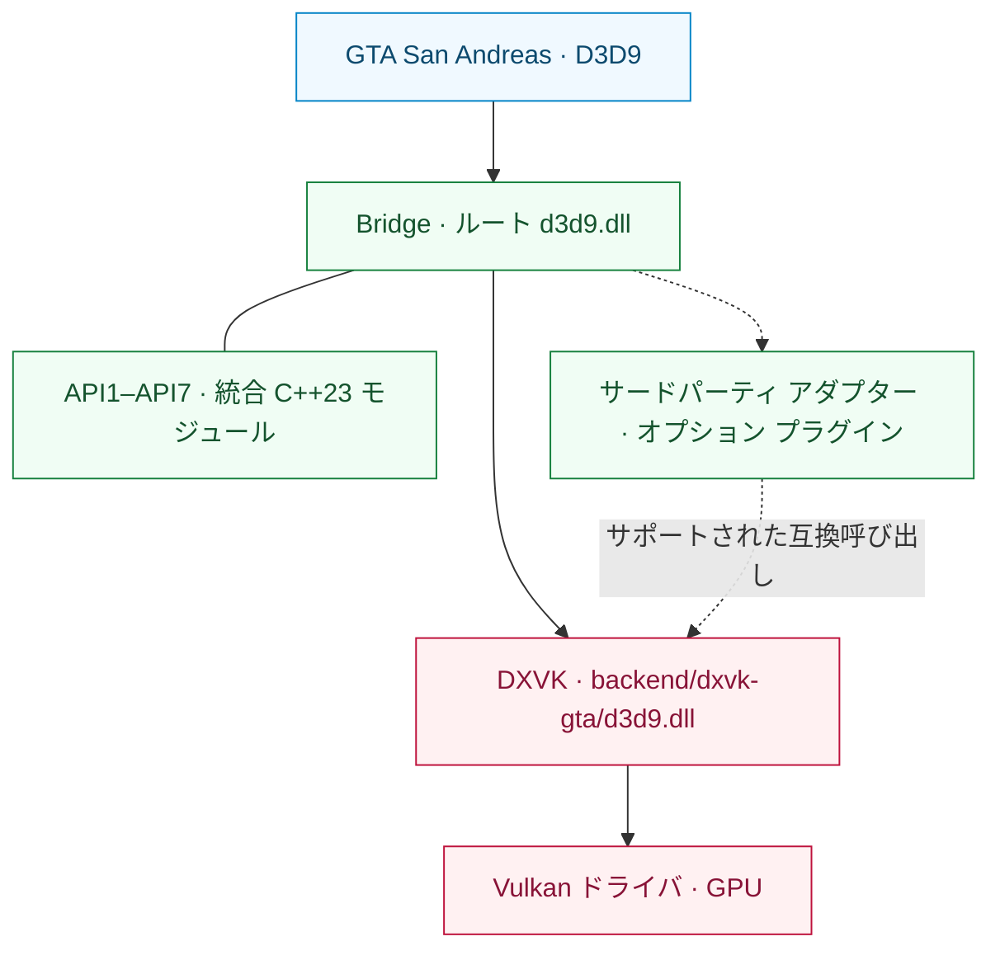

<div align="center">

# SA RenderStack

**グランド・セフト・オート：サンアンドレアス向けのモジュール式レンダリングランタイム。**

D3D9互換性 · Vulkanバックエンド実行 · 検証可能なレンダリング診断

[English](README.md) | [Português (Brasil)](README.pt-BR.md) | [Español](README.es.md) | [Русский](README.ru.md) | [Français](README.fr.md) | [Deutsch](README.de.md) | [日本語](README.ja.md) | [한국어](README.ko.md) | [简体中文](README.zh-CN.md)

[](https://github.com/prematurely/sa-renderstack/actions/workflows/windows-ci.yml)
[](https://github.com/prematurely/sa-renderstack/releases/tag/v0.1.0-alpha.1)
[](#build)
[](#architecture)
[](#compatibility)

[ダウンロード](https://github.com/prematurely/sa-renderstack/releases/tag/v0.1.0-alpha.1) | [クイックスタート](#quick-start) | [アーキテクチャ](#architecture) | [APIモジュール](#api-modules) | [ビルド手順](#build) | [ドキュメント](#documentation)

</div>

---

SA RenderStack は、D3D9 Bridge、GTA互換のDXVKフォーク、およびレンダリング診断機能を1つのソースプロジェクトに統合したものです。Bridgeがエントリーポイント、設定されたサードパーティ統合、互換アダプターを管理し、DXVKがD3D9を実装してVulkanでの描画実行を担当します。

> **リリースのベースライン：** `v0.1.0-alpha.1`、GTA San Andreas **1.0 US / x86**、**2つのランタイムDLL**構成。本READMEでは、C++23 APIサブプロジェクトを含む最新の開発ツリーについても説明しています。ソースコード上に機能が存在することは、公開配布パッケージに含まれていることを保証するものではありません。

<a id="capabilities"></a>
## 機能一覧

| レイヤー | 提供機能 |
| :--- | :--- |
| **Bridge** | 単一のルートD3D9エントリーポイント、順序付けされたモジュール登録、フック所有権メタデータ、および任意のプラグインライフサイクルコールバック。 |
| **DXVK バックエンド** | バックエンドDLLにDXGIファクトリのエクスポートを統合したD3D9からVulkanへの変換。 |
| **サードパーティ統合** | 互換アダプター、選択的ネイティブ状態ジャーナリング（Journaling）、および条件を満たした場合の一括ステート送信（Batch submission）。 |
| **API1–API7** | Bridgeに統合された7つのC++23サブプロジェクト（ライブラリソース、開発サンプル、テストを含む）。 |
| **診断機能** | ステート帰属追跡、CPUホットスポットサンプリング、ドロートレース、およびバックエンド実行統計。 |
| **リリースコントロール** | ソースコード来歴追跡、ABI/エクスポート検証、ビルドメタデータ、パッケージマニフェスト、およびロールバックファイルの整合性確認。 |

ステートブロックフィルタリング、遅延バインディング、リソースキャッシュ、および任意の追加スレッドスケジューリングは設定可能な実験的機能です。これらの機能が存在していても、あらゆるワークロードでパフォーマンスの向上が保証されるわけではありません。

<a id="quick-start"></a>
## クイックスタート

1. [リリース ページ](https://github.com/prematurely/sa-renderstack/releases/tag/v0.1.0-alpha.1) から **`SA-RenderStack-v0.1.0-alpha.1-split.zip`** をダウンロードします。
2. ゲーム本体およびランチャーのプロセスを終了します。上書きされるすべてのファイル（2つのランタイムDLLおよび設定ファイルを含む）のバックアップを作成してください。
3. `gta_sa.exe` が存在するゲームのルートディレクトリに、アーカイブ内のフォルダ構造を維持したまま解凍・展開します。
4. メニューからセーブデータへのロードを確認し、代表的なシーンや導入しているMOD構成で動作を検証してください。

配布されている `split` アーカイブがランタイム本体です。SDKおよびシンボルパッケージは開発支援用であり、導入作業にコンパイラやPowerShellは不要です。

既存環境を置き換える前に、必ず [インストールおよびロールバックガイド](docs/installation.md) をご確認ください。

<a id="runtime-layout"></a>
## ランタイム構成

```text
<GTA インストールディレクトリ>/
  gta_sa.exe
  d3d9.dll                       # Bridge エントリーポイント
  SA.RenderStack.ini             # Bridge 設定ファイル
  dxvk.conf                      # バックエンド設定ファイル
  backend/
    dxvk-gta/d3d9.dll            # DXVK D3D9 + DXGI バックエンド
  scripts/
    BridgeD3D9.ini               # 旧バージョンの設定ファイル配置場所
```

**2つのDLLは必ず指定されたパスに配置してください。** バックエンドDLLをルートの `d3d9.dll` に直接上書き配置するとBridgeをバイパスしてしまいます。統合されたDXGIエクスポートはバックエンドに属しており、本プロジェクトは2つのDLLに分離された構成となっています。

<a id="architecture"></a>
## アーキテクチャ



Bridgeは統合および診断を管理します。DXVKは権威あるD3D9ステート、Vulkanデバイス、各種リソース、コマンドストリーム、およびキューへの送信を制御します。ステート最適化を行う際は、この権威レイヤー内でのネイティブジャーナルの復元とステートブロックの変更を考慮する必要があります。

API2のコールバックは、既存のPresentコマンドバッファに記録されます。変更したイメージレイアウトは必ず復元する必要があり、コールバック内から独自にサブミット、終了、リセット、または再帰的な登録を行ってはなりません。詳細は [モジュールマップ](docs/architecture/module-map.md) および [バックエンドAPI規約](sdk/include/sa_renderstack/backend_api.h) を参照してください。

<a id="api-modules"></a>
## API1–API7 サブプロジェクト

**1つの親ランタイム、7つのコードモジュール。** BridgeのWin32プロジェクトには、`src/bridge/legacy/api-projects/` にあるこれらの実装が含まれます。これらに含まれるサンプルやテストは開発用の検証ターゲットであり、個別に単独実行される7つのプログラムではありません。

| API | 統合サブプロジェクト | 担当領域 |
| :---: | :--- | :--- |
| **1** | [Status](src/bridge/legacy/api-projects/api1-status/) | バージョン/機能の検証およびVulkanインターロップアクセス。 |
| **2** | [Vulkan Pass](src/bridge/legacy/api-projects/api2-vulkan-pass/) | パスの登録、実行順序管理、および登録解除。 |
| **3** | [State Batch](src/bridge/legacy/api-projects/api3-state-batch/) | シェーダー定数範囲およびテクスチャバインディングの送信。 |
| **4** | [State Journal](src/bridge/legacy/api-projects/api4-state-journal/) | サポート対象のパイプラインステートのキャプチャと復元。 |
| **5** | [Effect Batch](src/bridge/legacy/api-projects/api5-effect-batch/) | 最終エフェクトパスのステートを一括送信。 |
| **6** | [State + Draw](src/bridge/legacy/api-projects/api6-state-draw/) | ステートバッチと1回の即時DP/DIP呼び出しの送信。 |
| **7** | [Selective Journal](src/bridge/legacy/api-projects/api7-selective-journal/) | 自身が所有するエフェクト処理に対象を限定したキャプチャ。 |

インターフェースの提供、Bridgeへのコンパイル、および実際の運用環境での採用はそれぞれ独立した事実です。現在のプロファイルでは、設定されたサードパーティ統合パスを通じてAPI3およびAPI7を実行しています。API2は登録済みパスを必要とします。API5およびAPI6のライブラリやサンプルは、ゲームのホットパスでの使用を意味するものではありません。API6は**単一ドロー（single-draw）**インターフェースであり、複数オブジェクトやマルチドローキューを対象としたものではありません。

これらはバックエンド互換APIのバージョンです。個別の [Bridge プラグイン API](src/bridge/legacy/BridgeD3D9Plugin.h) は独自のv1/v2バージョニングを採用しています。

<a id="configuration"></a>
## 設定

| ファイル | 管理範囲 |
| :--- | :--- |
| [SA.RenderStack.ini](config/SA.RenderStack.ini) | Bridge統合、モジュールレジストリ、診断機能、および任意の追加スケジューリング。 |
| [dxvk.conf](config/dxvk.conf) | DXVKオプション、GTA互換性機能、フレームペーシング、およびHUD表示。 |

現在のBridgeは、ルートディレクトリの `SA.RenderStack.ini` を優先して読み込み、存在しない場合に `scripts/BridgeD3D9.ini` にフォールバックします。旧ビルドを使用する場合は、これら2つの同期を維持してください。ベースラインとしては、選択したリリースに付属する設定を使用してください。

レジストリは設定されたサードパーティモジュールを監視し、任意で統合可能な無効化エントリを提供します。不足しているサードパーティコンポーネントが自動的にインストールされることはありません。詳細は [プロキシおよびプラグインホスティング](src/bridge/legacy/POSTFX_CHAIN.md) を参照してください。

> **開発環境向けの設定：** 任意の `[Affinity] PerThread` および `Mmcss` はデフォルトで `0` に設定されています。これらを有効化することは実験的なものであり、リアルタイム処理や排他的コア割り当てを保証するものではありません。診断HUDの内容や最適化スイッチは、公開されたアルファプロファイルと異なる場合があります。

<a id="build"></a>
## ソースからのビルド

メインのビルド対象は **Windows / Release / x86** です。現在のソースコードは **C++23** を使用しています。BridgeプロジェクトはMSVCの `stdcpplatest` モードを選択し、APIのCMakeターゲットは `cxx_std_23` を要求します。

| ツールチェーン | 用途 |
| :--- | :--- |
| PowerShell 7 および Git | ビルドオーケストレーションおよび履歴来歴検証。 |
| Visual Studio 18 C++ Build Tools | Bridge および MSVC テストターゲット（ツールセット `v145`）。 |
| LLVM-MinGW, Python 3, Meson, Ninja, glslang | x86 DXVK バックエンドおよびシェーダーのコンパイル。 |
| CMake 3.25+ | APIサンプルおよびユニットテストの統合ビルド（任意）。 |

リポジトリのルートで実行します：

```powershell
pwsh -NoProfile -File tools/build.ps1 `
  -Configuration Release -Architecture x86 -Component All -Clean

pwsh -NoProfile -File tools/test.ps1 `
  -Configuration Release -Architecture x86
```

ビルド成果物は `out/` に出力されます。これらのコマンドはゲームディレクトリへの自動配置を行いません。明示的なツールパスや環境固有のオプションについては、各スクリプトの `-Help` を参照してください。

<details>
<summary><strong>統合APIサンプルおよびテストのビルド手順</strong></summary>

個別のAPIディレクトリではなく、親アグリゲートに対して設定を行います：

```powershell
cmake -S src/bridge/legacy/api-projects -B out/api-project-build/all `
  -G "Visual Studio 18 2026" -A Win32
cmake --build out/api-project-build/all --config Release
ctest --test-dir out/api-project-build/all -C Release --output-on-failure
```

メインのMSBuildパスは、APIライブラリのソースをBridge内に直接コンパイルします。この追加のCMakeパスは、サンプルコードおよびそのユニットテストを追加でビルドします。GPUサンプルを実行する際は、DXVK互換設定を明示的に指定し、適切なバックエンド環境に対して実行してください。

</details>

<a id="validation"></a>
## 検証とパッケージング

ビルドおよびテストが正常に完了した後：

```powershell
pwsh -NoProfile -File tools/package.ps1 `
  -Version 0.1.0-alpha.1 -Configuration Release
pwsh -NoProfile -File tests/package-layout-test.ps1
pwsh -NoProfile -File tools/release-gate.ps1 `
  -Version 0.1.0-alpha.1 -Configuration Release
```

| 検証項目 | 出力先 |
| :--- | :--- |
| ビルド識別情報およびバイナリハッシュ | `out/build-metadata.json` |
| テスト別結果、失敗、およびスキップ詳細 | `out/test-results.json` |
| Split、SDK、シンボル、およびソースマニフェスト | `out/packages/` |
| ローカルリリースゲート判定結果 | `out/reports/phase-1-release-gate.md` |

[Windows CI](.github/workflows/windows-ci.yml) はビルド、テスト、パッケージング、およびパッケージレイアウトの検査を実行します。ホステッドランナー上でのCI実行では、GPUプローブやローカルゲーム依存の検証は明示的にスキップされ、その理由がテストレポートに記録されます。CIバッジが正常であっても、実機でのゲーム内動作確認やローカルリリースゲートの代替にはなりません。

<a id="diagnostics"></a>
## 診断機能

| キャプチャ | 出力先 | 用途 |
| :--- | :--- | :--- |
| **F7** | `scripts/BridgeD3D9.state-attribution.log` および DXVK セッションログ | エフェクト/ステート帰属追跡およびバックエンドの一括処理検証。 |
| **F8** | `scripts/BridgeD3D9.cpuhotspots.log`, `Diagnostics/CPU/` | CPUホットスポットのサンプリングおよびキャプチャ画像。 |
| **F9** | `scripts/BridgeD3D9.callsites.log` | D3D9コールサイトのサンプリング（任意）。 |
| **F10** | `scripts/BridgeD3D9.drawtrace.log` | ドローコールごとのステート追跡（任意）。 |
| **バックエンド** | `Diagnostics/DXVK/` | デバイス、設定、およびセッション診断情報。 |

キー割り当てと出力内容は有効化されている設定によって異なります。詳細なキャプチャやHUDクエリはオーバーヘッドを伴います。通常のレンダリング性能を測定する場合は、同一のシーン、バイナリ、および設定を使用して個別にベンチマークを実施してください。

<a id="compatibility"></a>
## 互換性と対象範囲

動作ベースラインは **GTA San Andreas 1.0 US（32ビット）** であり、Bridgeエントリーポイントと DXVK v3.0.1 派生のVulkanバックエンドを使用します。このバックエンドを動作させるには、正常に動作するVulkanドライバが必須です。

公開されているパッケージは、GTA San Andreas 1.0 US 向けの x86 分離DLL（split-DLL）ランタイムを対象としています。レジストリおよび互換APIはサードパーティ製MODとの統合用拡張ポイントを提供しますが、特定の組み合わせへの対応状況はそれぞれのインターフェース仕様および検証結果に依存します。単一DLL（single-DLL）構成のランタイムは個別の開発ターゲットとして残されています。

FPS、テクスチャストリーミング、シェーダーの表示品質、入力遅延、および長時間の安定性は、固定された同一ワークロードを用いて測定する必要があります。[既知の監査結果および手動確認項目](docs/development/known-audit-findings.md) をご参照ください。

<a id="documentation"></a>
## ドキュメント一覧

| ドキュメント | 主要内容 |
| :--- | :--- |
| [インストール](docs/installation.md) | パッケージ構成、初回起動、およびロールバック手順。 |
| [アーキテクチャ](docs/architecture/module-map.md) | モジュールの責務とレンダリング規約。 |
| [APIサブプロジェクト](src/bridge/legacy/api-projects/README.md) | Bridgeが所有する7つのコードモジュール。 |
| [メンテナー引き継ぎ資料](docs/development/phase-1-handoff.md) | ビルドおよびリリース関連の背景情報。 |
| [監査結果](docs/development/known-audit-findings.md) | 既知の制限事項と検証要件。 |
| [リリースノート](docs/releases/0.1.0-alpha.1.md) | 公開アルファバージョンの対象範囲。 |

```text
backend/dxvk/                    Vulkan バックエンドおよび GTA 互換レイヤー
src/bridge/legacy/               メイン Bridge ランタイムおよびアダプター
  api-projects/                  7つの統合 C++23 API サブプロジェクト
sdk/include/sa_renderstack/      パブリック バックエンド API
config/                         バージョン管理されたランタイムプロファイル
docs/                           アーキテクチャ、開発ガイド、およびリリースノート
packaging/                      パッケージ配置仕様
tests/                          ソース、ABI、パッケージング、およびリグレッション検証
tools/                          ビルド、テスト、パッケージング、およびリリース自動化
```

<a id="licenses"></a>
## 出典とライセンス

バックエンドは [公式 DXVK v3.0.1](https://github.com/doitsujin/dxvk/tree/v3.0.1) から派生しています。その [アップストリーム情報](backend/dxvk/SA_RENDERSTACK_UPSTREAM.toml) および [依存関係リビジョン](backend/dxvk/SA_RENDERSTACK_DEPENDENCIES.toml) はソースツリーに記録されています。

SA RenderStack 固有のコードは [zlib/libpng ライセンス](LICENSE) に基づいて提供されます。取り込まれたサードパーティ製コンポーネントは各々のライセンスを保持しており、[サードパーティ表示](THIRD_PARTY_NOTICES.md) に記載されています。生成されるソースマニフェストには、リリース候補ごとのファイルハッシュおよびツールチェーンのメタデータが記録されます。
