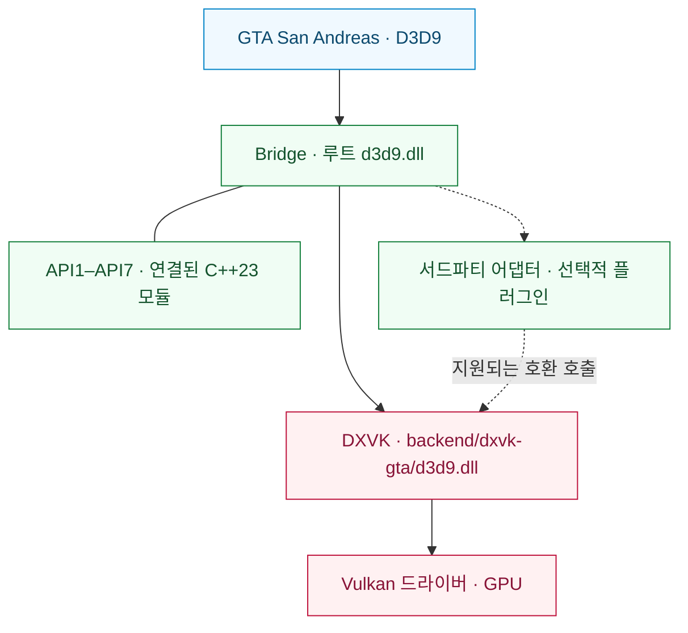

<div align="center">

# SA RenderStack

**Grand Theft Auto: San Andreas를 위한 모듈형 렌더링 런타임.**

D3D9 호환성 · Vulkan 실행 · 검사 가능한 렌더링 진단

[English](README.md) | [Português (Brasil)](README.pt-BR.md) | [Español](README.es.md) | [Русский](README.ru.md) | [Français](README.fr.md) | [Deutsch](README.de.md) | [日本語](README.ja.md) | [한국어](README.ko.md) | [简体中文](README.zh-CN.md)

[](https://github.com/prematurely/sa-renderstack/actions/workflows/windows-ci.yml)
[](https://github.com/prematurely/sa-renderstack/releases/tag/v0.1.0-alpha.1)
[](#build)
[](#architecture)
[](#compatibility)

[다운로드](https://github.com/prematurely/sa-renderstack/releases/tag/v0.1.0-alpha.1) | [빠른 시작](#quick-start) | [아키텍처](#architecture) | [API 모듈](#api-modules) | [빌드](#build) | [문서](#documentation)

</div>

---

SA RenderStack은 D3D9 Bridge, GTA와 호환되는 DXVK 포크 및 렌더링 진단 도구를 하나의 소스 프로젝트로 통합합니다. Bridge는 진입점, 구성된 서드파티 통합 및 호환성 어댑터를 관리합니다. DXVK는 D3D9를 구현하고 Vulkan 실행을 담당합니다.

> **릴리스 기준:** `v0.1.0-alpha.1`, GTA San Andreas **1.0 US / x86**, **2개의 런타임 DLL** 구성. 이 README는 C++23 API 하위 프로젝트를 포함한 현재 개발 트리에 대해서도 설명합니다. 소스 코드에 기능이 존재한다고 해서 배포된 릴리스 아카이브에 해당 기능이 포함되어 있음을 보장하지는 않습니다.

<a id="capabilities"></a>
## 주요 기능

| 계층 | 제공하는 기능 |
| :--- | :--- |
| **Bridge** | 단일 루트 D3D9 진입점, 순서화된 모듈 등록, 후크 소유권 메타데이터 및 선택적 플러그인 수명 주기 콜백. |
| **DXVK 백엔드** | DXGI 팩토리 내보내기(Export)가 백엔드 DLL에 병합된 D3D9 to Vulkan 변환. |
| **서드파티 통합** | 호환성 어댑터, 선택적 네이티브 상태 저널링(Journaling), 적격한 경우 상태 일괄 제출(Batch submission). |
| **API1–API7** | Bridge에 연결된 7개의 C++23 하위 프로젝트(라이브러리 소스, 개발 예제 및 테스트 포함). |
| **진단 도구** | 상태 귀속, CPU 핫스팟 샘플링, 드로우 트레이스 및 백엔드 실행 통계. |
| **릴리스 툴링** | 소스 출처 추적, ABI/내보내기 검사, 빌드 메타데이터, 패키지 매니페스트 및 롤백 파일 무결성 검증. |

상태 블록(State-block) 필터링, 지연 바인딩, 리소스 캐시 및 선택적 스레드 스케줄링은 구성 가능한 실험적 기능입니다. 이러한 기능이 존재한다고 해서 모든 워크로드에서 성능 향상이 보장되는 것은 아닙니다.

<a id="quick-start"></a>
## 빠른 시작

1. [릴리스 페이지](https://github.com/prematurely/sa-renderstack/releases/tag/v0.1.0-alpha.1)에서 **`SA-RenderStack-v0.1.0-alpha.1-split.zip`**을 다운로드합니다.
2. 게임 및 런처 프로세스를 종료합니다. 두 런타임 DLL과 구성 파일을 포함하여 패키지가 덮어쓸 모든 파일을 백업합니다.
3. 압축 파일 내의 디렉터리 경로를 유지하면서 `gta_sa.exe`가 위치한 게임 디렉터리에 압축을 풉니다.
4. 메뉴에서 세이브 파일 로딩이 정상적으로 작동하는지 확인한 후, 대표적인 게임 씬 및 대상 모드 구성을 검증합니다.

분할(split) 압축 파일이 런타임 패키지입니다. SDK 및 심볼 패키지는 개발 지원용이며, 설치 시 컴파일러나 PowerShell이 필요하지 않습니다.

기존 환경을 교체하기 전에 [설치 및 롤백 가이드](docs/installation.md)를 반드시 확인하십시오.

<a id="runtime-layout"></a>
## 런타임 레이아웃

```text
<GTA 디렉터리>/
  gta_sa.exe
  d3d9.dll                       # Bridge 진입점
  SA.RenderStack.ini             # Bridge 구성 파일
  dxvk.conf                      # 백엔드 구성 파일
  backend/
    dxvk-gta/d3d9.dll            # DXVK D3D9 + DXGI 백엔드
  scripts/
    BridgeD3D9.ini               # 기존 레거시 구성 위치
```

**두 DLL을 항상 지정된 경로에 유지하십시오.** 백엔드 DLL을 루트의 `d3d9.dll`에 복사하면 Bridge를 우회하게 됩니다. 병합된 DXGI 내보내기는 백엔드에 속하며, 본 런타임은 여전히 두 개의 DLL로 분리된 구조입니다.

<a id="architecture"></a>
## 아키텍처



Bridge는 통합 및 진단을 관리합니다. DXVK는 신뢰할 수 있는(authoritative) D3D9 상태, Vulkan 장치, 리소스, 커맨드 스트림 및 큐 제출을 직접 소유하고 제어합니다. 상태 최적화 작업은 해당 신뢰 계층에서의 네이티브 저널 복원과 상태 블록 변경을 반드시 고려해야 합니다.

API2 콜백은 기존 Present 커맨드 버퍼에 기록됩니다. 변경한 이미지 레이아웃은 반드시 복원해야 하며, 콜백 내에서 자체적으로 제출, 종료, 재설정 또는 재귀 등록을 수행해서는 안 됩니다. 자세한 내용은 [모듈 맵](docs/architecture/module-map.md) 및 [백엔드 API 계약](sdk/include/sa_renderstack/backend_api.h)을 참조하십시오.

<a id="api-modules"></a>
## API1–API7 하위 프로젝트

**하나의 상위 런타임, 일곱 개의 코드 모듈.** 두 Bridge Win32 프로젝트는 모두 `src/bridge/legacy/api-projects/`의 구현을 포함합니다. 여기에 포함된 예제와 테스트는 개발 검증 대상이며, 독립적으로 배포되는 7개의 개별 프로그램이 아닙니다.

| API | 연결된 하위 프로젝트 | 역할 |
| :---: | :--- | :--- |
| **1** | [Status](src/bridge/legacy/api-projects/api1-status/) | 버전/기능 검사 및 Vulkan 상호 운용(Interop) 접근. |
| **2** | [Vulkan Pass](src/bridge/legacy/api-projects/api2-vulkan-pass/) | 패스 등록, 실행 순서 지정 및 등록 해제. |
| **3** | [State Batch](src/bridge/legacy/api-projects/api3-state-batch/) | 셰이더 상수 범위 및 텍스처 바인딩 일괄 제출. |
| **4** | [State Journal](src/bridge/legacy/api-projects/api4-state-journal/) | 지원되는 파이프라인 상태 캡처 및 복원. |
| **5** | [Effect Batch](src/bridge/legacy/api-projects/api5-effect-batch/) | 최종 이펙트 패스 상태를 배치로 제출. |
| **6** | [State + Draw](src/bridge/legacy/api-projects/api6-state-draw/) | 상태 배치 및 단일 즉각 DP/DIP 호출 제출. |
| **7** | [Selective Journal](src/bridge/legacy/api-projects/api7-selective-journal/) | 소유한 이펙트 작업으로 범위를 한정한 캡처. |

인터페이스의 존재, Bridge로의 컴파일, 실제 프로덕션 환경에서의 채택 여부는 별개의 사실입니다. 현재 프로필은 구성된 서드파티 통합 경로를 통해 API3 및 API7을 실행합니다. API2는 등록된 패스가 필요합니다. API5/API6 라이브러리 및 예제는 게임의 핫패스(Hot path)에서의 채택을 의미하지 않습니다. API6은 **단일 드로우(single-draw)** 인터페이스이며 다중 객체 또는 다중 드로우 큐가 아닙니다.

이들은 백엔드 호환성 API 버전입니다. 별도의 [Bridge 플러그인 API](src/bridge/legacy/BridgeD3D9Plugin.h)는 자체 v1/v2 버전을 사용합니다.

<a id="configuration"></a>
## 구성

| 파일 | 역할 |
| :--- | :--- |
| [SA.RenderStack.ini](config/SA.RenderStack.ini) | Bridge 통합, 모듈 레지스트리, 진단 도구 및 선택적 스케줄링. |
| [dxvk.conf](config/dxvk.conf) | DXVK 옵션, GTA 호환성 기능, 프레임 페이싱 및 HUD. |

현재 Bridge는 루트의 `SA.RenderStack.ini`를 먼저 읽고, 없는 경우 `scripts/BridgeD3D9.ini`로 대체합니다. 이전 빌드를 사용하는 경우 두 복사본의 동기화를 유지하십시오. 선택한 릴리스와 함께 제공된 구성을 기본값으로 사용하십시오.

레지스트리는 구성된 서드파티 모듈을 모니터링하고 선택적 통합을 위한 비활성화된 항목을 제공합니다. 누락된 서드파티 구성 요소는 레지스트리에 의해 자동으로 설치되지 않습니다. 자세한 내용은 [프록시 및 플러그인 호스팅](src/bridge/legacy/POSTFX_CHAIN.md)을 참조하십시오.

> **개발 구성 안내:** 선택적인 `[Affinity] PerThread` 및 `Mmcss`는 기본값이 `0`입니다. 이를 활성화하는 것은 실험적인 기능이며, 실시간 처리 또는 배타적 코어 할당을 보장하지 않습니다. 진단 HUD 내용 및 최적화 스위치는 공개된 알파 프로필과 다를 수 있습니다.

<a id="build"></a>
## 소스 빌드

기본 빌드 대상은 **Windows / Release / x86**입니다. 현재 소스는 **C++23**을 사용합니다. Bridge 프로젝트는 MSVC의 `stdcpplatest` 모드를 선택하며, API CMake 대상은 `cxx_std_23`을 요구합니다.

| 툴체인 | 목적 |
| :--- | :--- |
| PowerShell 7 및 Git | 빌드 오케스트레이션 및 히스토리 출처 검증. |
| Visual Studio 18 C++ Build Tools | Bridge 및 MSVC 테스트 타겟(툴셋 `v145`). |
| LLVM-MinGW, Python 3, Meson, Ninja, glslang | x86 DXVK 백엔드 및 셰이더 빌드. |
| CMake 3.25+ | API 예제 및 단위 테스트의 선택적 통합 빌드. |

저장소 루트에서 다음을 실행합니다:

```powershell
pwsh -NoProfile -File tools/build.ps1 `
  -Configuration Release -Architecture x86 -Component All -Clean

pwsh -NoProfile -File tools/test.ps1 `
  -Configuration Release -Architecture x86
```

빌드 출력물은 `out/`에 생성됩니다. 이 명령들은 게임 디렉터리에 자동으로 배포하지 않습니다. 명시적 도구 경로 및 환경별 옵션은 각 스크립트의 `-Help`를 참조하십시오.

<details>
<summary><strong>통합 API 예제 및 테스트 빌드</strong></summary>

개별 API 디렉터리가 아닌 상위 집합 프로젝트를 구성하십시오:

```powershell
cmake -S src/bridge/legacy/api-projects -B out/api-project-build/all `
  -G "Visual Studio 18 2026" -A Win32
cmake --build out/api-project-build/all --config Release
ctest --test-dir out/api-project-build/all -C Release --output-on-failure
```

기본 MSBuild 경로는 API 라이브러리 소스를 Bridge에 컴파일합니다. 이 선택적 CMake 경로는 예제 및 해당 단위 테스트를 추가로 빌드합니다. GPU 예제는 명시적인 DXVK 호환 구성을 통해 의도한 백엔드 환경에서 실행해야 합니다.

</details>

<a id="validation"></a>
## 검증 및 패키징

성공적인 빌드 및 테스트 실행 후:

```powershell
pwsh -NoProfile -File tools/package.ps1 `
  -Version 0.1.0-alpha.1 -Configuration Release
pwsh -NoProfile -File tests/package-layout-test.ps1
pwsh -NoProfile -File tools/release-gate.ps1 `
  -Version 0.1.0-alpha.1 -Configuration Release
```

| 검증 항목 | 출력 위치 |
| :--- | :--- |
| 빌드 식별 정보 및 바이너리 해시 | `out/build-metadata.json` |
| 테스트별 결과, 실패 및 건너뛰기 정보 | `out/test-results.json` |
| 분할, SDK, 심볼 및 소스 매니페스트 | `out/packages/` |
| 로컬 릴리스 게이트 판정 결과 | `out/reports/phase-1-release-gate.md` |

[Windows CI](.github/workflows/windows-ci.yml)는 빌드, 테스트, 패키징 및 패키지 검사를 수행합니다. 호스팅 실행 환경에서는 GPU 프로브 및 로컬 게임 증거 검사를 명시적으로 건너뛰고 테스트 보고서에 이유를 기록합니다. CI 통과 배지가 실제 게임 내 테스트나 로컬 릴리스 게이트 검증을 대체할 수는 없습니다.

<a id="diagnostics"></a>
## 진단 기능

| 캡처 | 출력 위치 | 용도 |
| :--- | :--- | :--- |
| **F7** | `scripts/BridgeD3D9.state-attribution.log` 및 DXVK 세션 로그 | 이펙트/상태 귀속 및 백엔드 배치 처리 확인. |
| **F8** | `scripts/BridgeD3D9.cpuhotspots.log`, `Diagnostics/CPU/` | CPU 핫스팟 샘플 및 캡처 이미지. |
| **F9** | `scripts/BridgeD3D9.callsites.log` | 선택적 D3D9 호출 지점 샘플링. |
| **F10** | `scripts/BridgeD3D9.drawtrace.log` | 선택적 드로우별 상태 추적. |
| **백엔드** | `Diagnostics/DXVK/` | 장치, 구성 및 세션 진단 정보. |

단축키 및 출력 파일은 활성화된 구성에 따라 다릅니다. 상세 캡처 및 HUD 쿼리는 오버헤드를 발생시킵니다. 일반적인 렌더링 성능을 측정할 때는 동일한 씬, 바이너리 및 구성을 사용하여 별도로 벤치마크를 수행하십시오.

<a id="compatibility"></a>
## 호환성 및 범위

기준 환경은 **GTA San Andreas 1.0 US, 32비트**이며, Bridge 진입점과 DXVK v3.0.1 기반 Vulkan 백엔드를 사용합니다. 이 백엔드에는 올바르게 작동하는 Vulkan 드라이버가 필요합니다.

배포된 패키지는 GTA San Andreas 1.0 US용 x86 분할 DLL 런타임을 대상으로 합니다. 레지스트리 및 호환성 API는 서드파티 통합을 위한 확장 지점을 제공하며, 특정 조합에 대한 지원은 해당 인터페이스 계약 및 검증 결과에 따라 달라집니다. 단일 DLL 런타임은 별도의 개발 목표로 남아 있습니다.

FPS, 텍스처 스트리밍, 셰이더 표현, 입력 지연 시간 및 장시간 세션 안정성은 고정된 동일 워크로드로 측정해야 합니다. 자세한 내용은 [알려진 감사 결과 및 수동 검사 항목](docs/development/known-audit-findings.md)을 참조하십시오.

<a id="documentation"></a>
## 문서

| 가이드 | 주요 내용 |
| :--- | :--- |
| [설치](docs/installation.md) | 패키지 구성, 첫 실행 및 롤백. |
| [아키텍처](docs/architecture/module-map.md) | 모듈 책임 및 렌더링 계약. |
| [API 하위 프로젝트](src/bridge/legacy/api-projects/README.md) | Bridge 소유의 7개 코드 모듈. |
| [메인테이너 인수인계](docs/development/phase-1-handoff.md) | 빌드 및 릴리스 컨텍스트. |
| [감사 결과](docs/development/known-audit-findings.md) | 알려진 한계 및 검증 요구 사항. |
| [릴리스 노트](docs/releases/0.1.0-alpha.1.md) | 공개 알파 범위. |

```text
backend/dxvk/                    Vulkan 백엔드 및 GTA 호환성 레이어
src/bridge/legacy/               메인 Bridge 런타임 및 어댑터
  api-projects/                  7개의 연결된 C++23 API 하위 프로젝트
sdk/include/sa_renderstack/      공개 백엔드 API
config/                         버전 관리된 런타임 프로필
docs/                           아키텍처, 개발 및 릴리스 노트
packaging/                      패키지 레이아웃 계약
tests/                          소스, ABI, 패키징 및 회귀 검사
tools/                          빌드, 테스트, 패키징 및 릴리스 자동화
```

<a id="licenses"></a>
## 출처 및 라이선스

백엔드는 [공식 DXVK v3.0.1](https://github.com/doitsujin/dxvk/tree/v3.0.1)에서 파생되었습니다. [업스트림 정보](backend/dxvk/SA_RENDERSTACK_UPSTREAM.toml) 및 [종속성 리비전](backend/dxvk/SA_RENDERSTACK_DEPENDENCIES.toml)은 소스 트리에 기록되어 있습니다.

SA RenderStack 고유 코드는 [zlib/libpng 라이선스](LICENSE)를 따릅니다. 포함된 서드파티 구성 요소는 각자의 라이선스를 유지하며, [서드파티 고지 사항](THIRD_PARTY_NOTICES.md)에 나열되어 있습니다. 생성된 소스 매니페스트에는 각 릴리스 후보에 대한 파일 해시 및 툴체인 메타데이터가 기록됩니다.
